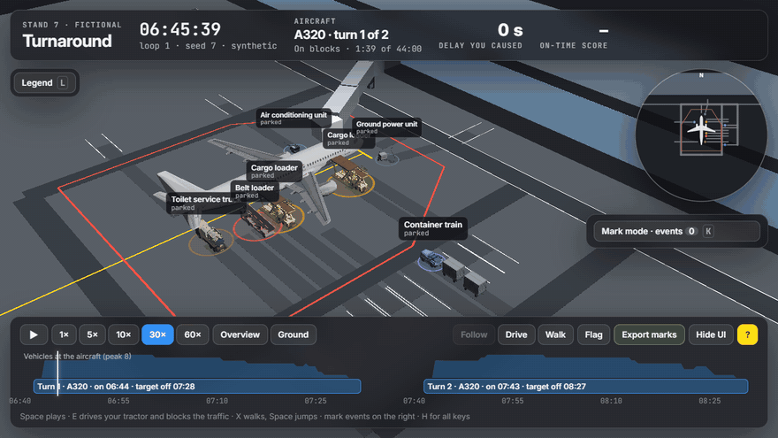
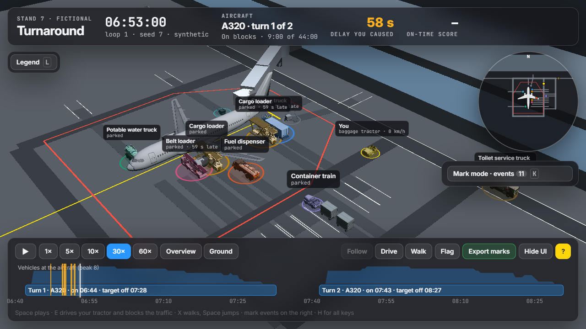

# Turnaround sim

[](https://darrylteo.github.io/turnaround-sim/)

**[Play it in the browser →](https://darrylteo.github.io/turnaround-sim/)** No install, no account, no API keys.

A 3D game of one stand on a busy morning: two A320 turnarounds with a gap between them, then the loop starts again.
Catering, fuel, cargo, water, toilet service, ground power and the pushback tug arrive on a synthetic schedule built
from the aircraft manufacturer's turn-round chart.

You can:
- **Drive** a baggage tractor into their way (E).
- **Walk and jump** among them (X, Space).
- **Mark** what the conflict detector got right and wrong, to build an eval set.



## What happens on the stand

- **Schedule.** A seeded generator turns the task table in [`data/`](data/a320-turnaround.json) into vehicle tracks on a
  small road graph: entry gates, staging bays, service spots and exits. Each task starts when its predecessors and its
  vehicle allow. Durations get noise, and now and then a vehicle runs late, so conflicts happen. A late catering
  truck pushes off-block back; a late fuel truck mostly doesn't, because fuelling has slack.
- **Replay.** Untouched, every vehicle follows its track exactly.
- **You.** Vehicles you block stop short and wait. After 10 s each takes a detour if the roads have one, or waits on.
  It then rejoins its track and runs late by the time it lost. The **delay counter** totals that lateness at the
  service spots, and the late work flows through the task dependencies to off-block. Each turn gets an **on-time
  score**: 100, less 5 per minute past the 44-minute target.
- **Detector.** It flags separation conflicts, late arrivals, blocked and rerouted vehicles, and speeding near the aircraft.
- **Mark mode.** Every detector event lands in a list where you give it a verdict: valid, false alarm or unsure.
  Press N to flag something the detector missed. **Export marks** downloads the lot as JSON (`turnaround-sim/marks@1`):
  an eval set of detector events with human labels.

## Evals first

The [evals](evals/README.md) were written and committed before the features they test, and run headless in CI on
every push: 56 checks in 9 files, about 20 s, with no dependencies beyond Node.

| Area | What is checked |
|---|---|
| Generator | Reproduces the A320 chart (44.2 min) and the 737-800 cross-check (37.5 min). Keeps every task's precedence over 200 seeds. Never refuels with passengers on board. Never parks a vehicle at the aircraft before chocks |
| Replay | Every vehicle stays within 1 cm of its track. The same seed and the same inputs give an identical run |
| Waiting, rerouting | Vehicles stop short of you and never drive through you. They detour round a blocked road, or wait when there is no detour |
| Delay counter | Equals the time lost (±1 s) and never decreases. Critical-path delay moves off-block; delay inside slack doesn't |
| Handling | Speed, acceleration, braking and turn radius are capped. You can't drive into the aircraft or another vehicle. Physics doesn't depend on frame rate |
| Walking | Walk and run speeds. A jump peaks at v²/2g and lands after 2v/g. No double jump. No walking through the aircraft |
| Mark mode | Fixed verdicts, stable sorted export, JSON round trip |
| Loop | Two turns with an empty stand between them, then a clean restart |
| Leak check | No banned term in any file or commit message (see below) |

## Sources

Task durations, precedence, door positions, service points and GSE types come from public airport planning
documents. [SOURCES.md](SOURCES.md) has the links and how each value was read.

- Airbus, *A320 Aircraft Characteristics – Airport and Maintenance Planning*, Rev. 46 (Jul 2026), §2-7-0, §5-1, §5-2-0, §5-4.
- Boeing, *737 Airplane Characteristics for Airport Planning*, D6-58325-7 Rev. C (Oct 2025), §5.1.4, §5.2.4 (cross-check).

Only facts are encoded (minutes, rates, metres). No figures from either manual are reproduced. The stand, its roads
and all the traffic are fictional.

## Credits

Vehicle models from Sketchfab, all **CC BY 4.0**:

| Model | Author | Link |
|---|---|---|
| Airport Catering Truck | spot1studios | [sketchfab](https://sketchfab.com/3d-models/airport-catering-truck-289f4e2cfa3f4722b0476b1fc37681d8) |
| Fuel Truck | zairiqzairiq | [sketchfab](https://sketchfab.com/3d-models/fuel-truck-7542dfdb60e44eab9ba65a314146b1cd) |
| TLD 121 Aircraft loader | CourseDesign | [sketchfab](https://sketchfab.com/3d-models/tld-121-aircraft-loader-939a3c9a6d1d409a961d163fc4f16dc6) |
| Low poly belt loader | beli.estefano | [sketchfab](https://sketchfab.com/3d-models/low-poly-belt-loader-e00484568f4245cdb824e4d4e0cc95e5) |
| Aircraft tractor lowpoly model | propmaker1 | [sketchfab](https://sketchfab.com/3d-models/aircraft-tractor-lowpoly-model-2e9a078c365243c888f4c70f85be7b85) |
| Airport baggage equipment (cart) lowpoly | propmaker1 | [sketchfab](https://sketchfab.com/3d-models/airport-baggage-equipment-cart-lowpoly-7ae8444bb5044376a04ee7bb0664ff39) |
| GPU (Airport Ground Power Unit) | omri_ha_muglob | [sketchfab](https://sketchfab.com/3d-models/gpu-aiport-ground-power-unit-b18e62dda2e04e97a95312bb6a284f1c) |
| Industrial vacuum truck (stands in for the water and toilet trucks) | marketingbukom | [sketchfab](https://sketchfab.com/3d-models/industrial-vacuum-truck-8fe9c45cf4c0476ca4aa7a0531b5bd3f) |

Each was fitted to its real size, recoloured by role, and has its materials merged.

Other components:
- **Aircraft:** the A320 from [Flightradar24's fr24-3d-models](https://github.com/Flightradar24/fr24-3d-models), derived from the [FlightGear A320 family](https://github.com/FGMEMBERS/A320-family). **GPLv2**, in an unbranded white finish and scaled to the manual's length. The file `models/a320.glb` keeps that licence.
- **Rendering:** [CesiumJS](https://cesium.com/platform/cesiumjs/) 1.144 (Apache 2.0), loaded from jsDelivr. It runs with no imagery, no terrain and no access token.
- **Fonts:** Inter and JetBrains Mono (SIL Open Font License).

## Leak check

The leak check, [`scripts/leak-check.mjs`](scripts/leak-check.mjs), runs first in CI and fails the build on any
banned term in a tracked file, a model's glTF JSON, or a commit message. The list of terms is kept only as SHA-256
hashes ([`scripts/leak-hashes.json`](scripts/leak-hashes.json)), so the repo never names what it guards against.

## Run it locally

```bash
node scripts/serve.mjs
```

Then open http://localhost:8772. To run the evals:

```bash
npm test
```

`node scripts/hero.mjs` rebuilds the GIF above (it needs Chrome and ffmpeg).

## Licence

[MIT](LICENSE) for the code and data. The models keep their own licences, listed above.
